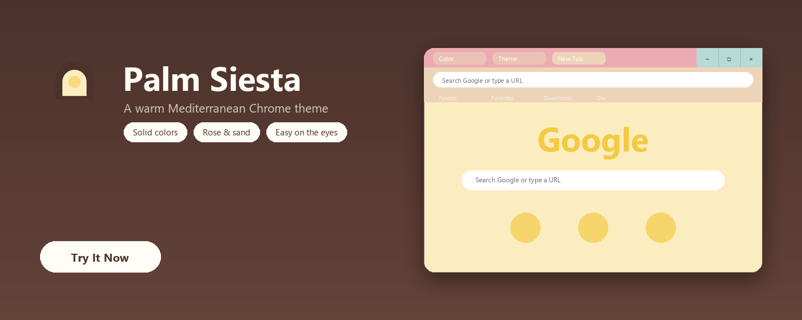
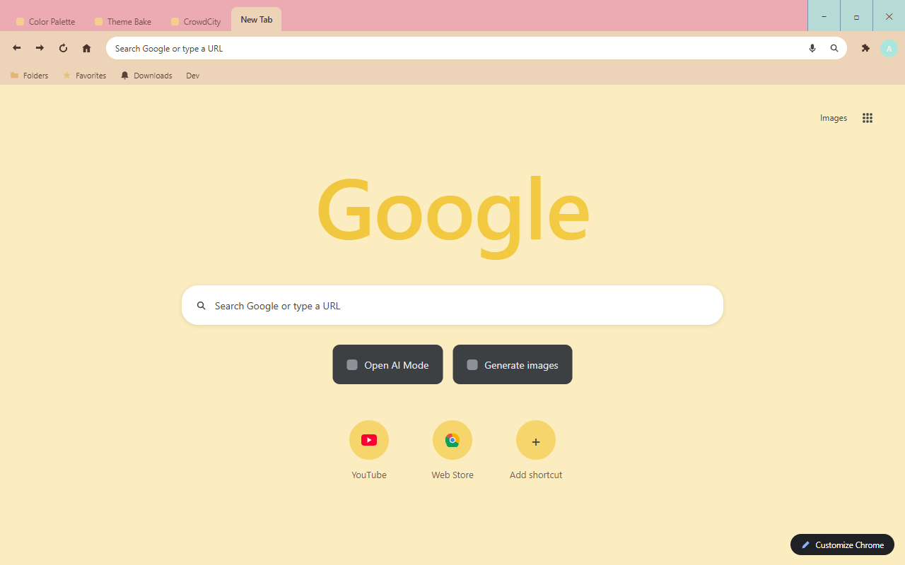
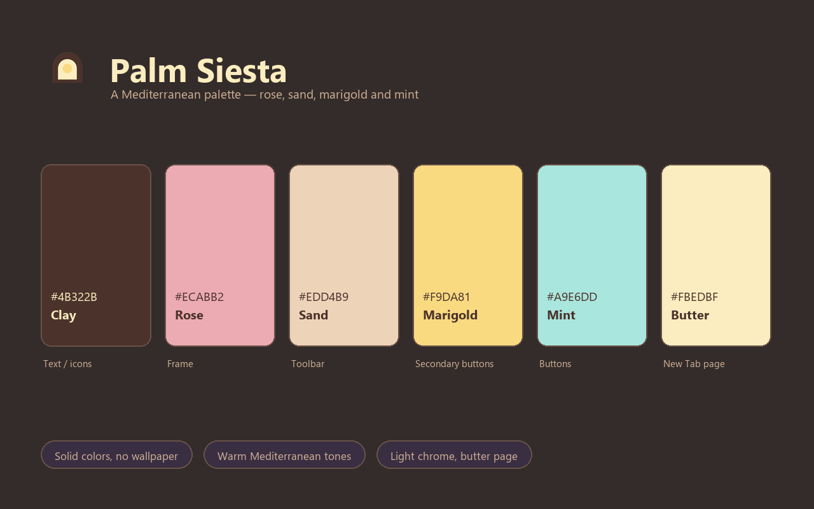

<p align="center">
  
</p>

<h1 align="center">Palm Siesta Theme</h1>

<p align="center">
  A warm Mediterranean Chrome theme: rose chrome, a sand toolbar and a butter New Tab Page.
</p>

<p align="center">
  
  
  
  
</p>

<p align="center">
  
</p>

## Overview

Palm Siesta is an afternoon on a Mediterranean terrace: a rose strip, a sand toolbar, and a butter-yellow New Tab Page where Chrome paints its mark in marigold. Deep clay ink keeps every tab, bookmark and toolbar icon readable on the light chrome; mint appears once (on buttons) as the only cool note in an otherwise warm room.

## Design Concept

Five pastels sit within a few lightness steps, so the theme leans on one dark anchor and a strict colour diet:

1. **One ink for everything** — deep clay `#4B322B` on all three surfaces (≈11:1 on the butter page).
2. **Three warm surfaces, kept apart by hue** — rose frame, sand toolbar, butter page; no gradients.
3. **Mint stays small** — buttons only. It is the only cool hue here and would fight the warm field if it spread.

| Color | Hex | RGB | Role |
|---|---|---|---|
| Clay | `#4B322B` | 75, 50, 43 | Text / icons |
| Rose | `#ECABB2` | 236, 171, 178 | Frame |
| Sand | `#EDD4B9` | 237, 212, 185 | Toolbar |
| Marigold | `#F9DA81` | 249, 218, 129 | Secondary buttons |
| Mint | `#A9E6DD` | 169, 230, 221 | Buttons |
| Butter | `#FBEDBF` | 251, 237, 191 | New Tab background |

## Features

- Pure color, no wallpaper — fast and distraction-free
- Warm Mediterranean palette: rose, sand, butter, marigold and a single mint accent
- Light chrome with deep clay ink — ≈11:1 contrast
- Tab text, bookmark text and toolbar icons all share the same clay ink
- Single-row shortcut row and a colour-matched mark for a clean New Tab Page
- No configuration needed — install and enjoy

## Screenshots

| Browser | Palette |
|:-:|:-:|
|  |  |

## Installation

### Load unpacked (development)

1. Download or clone this repository.
2. Open `chrome://extensions` in Chrome.
3. Enable **Developer mode** in the top right.
4. Click **Load unpacked** and select this folder (`palm-siesta-theme`).
5. The theme is active immediately.

### Package for the Chrome Web Store

```
chrome://extensions → Pack extension → select this folder → palm-siesta-theme.zip
```

Upload the resulting `.zip` to the [Chrome Web Store developer dashboard](https://chrome.google.com/webstore/devconsole).

## Store listing copy

Ready to paste into the store listing (also kept in `store-assets/store-description.txt`):

> Palm Siesta is a warm Mediterranean Chrome theme: a rose frame, a sand toolbar, and a butter-yellow New Tab Page. Deep clay ink keeps every tab, bookmark and toolbar icon readable on the light chrome, with mint and marigold accents. Solid colors only, no wallpaper.

## Project structure

| File | Purpose |
|---|---|
| `manifest.json` | Theme definition (single-file, inlined `theme` field) |
| `logo/logo.png` | 128×128 store icon (transparent background) |
| `store-assets/promo/440x280.png` | Small promo tile |
| `store-assets/promo/1400x560.png` | Marquee promo tile |
| `store-assets/screenshots/en/screenshot-1-browser.png` | Browser mockup screenshot (1280×800) |
| `store-assets/screenshots/en/screenshot-2-palette.png` | Palette introduction screenshot (1280×800) |
| `store-assets/store-description.txt` | Store listing description |
| `scripts/generate-logo-vector.py` | Render all SVG logo candidates with headless Chromium, export `logo/logo.png` from `SELECTED` |
| `scripts/generate-screenshot-headless.py` | Regenerate the browser mockup via Playwright |
| `scripts/generate-screenshot-2-palette.py` | Regenerate the palette screenshot |
| `scripts/generate-promo.py` | Regenerate both promo tiles (1400×560 window hero, 440×280 dot palette) |
| `LICENSE` | Non-Commercial License (English / 中文) |

## Regenerating assets

Every asset is code-generated, so nothing here is hand-drawn or hand-copied:

```bash
py -3 scripts/generate-logo-vector.py         # candidates + logo/logo.png
py -3 scripts/generate-screenshot-headless.py # store screenshot 1 (browser mockup)
py -3 scripts/generate-screenshot-2-palette.py # store screenshot 2 (palette)
py -3 scripts/generate-promo.py               # promo 440x280 + 1400x560
```

To ship a different icon candidate, change `SELECTED` at the top of `generate-logo-vector.py` and re-run, then re-run the three asset scripts so the promo and screenshots pick up the new logo.

## License

Palm Siesta Theme is released under the Non-Commercial License. See `LICENSE` for full text (English / 中文).
